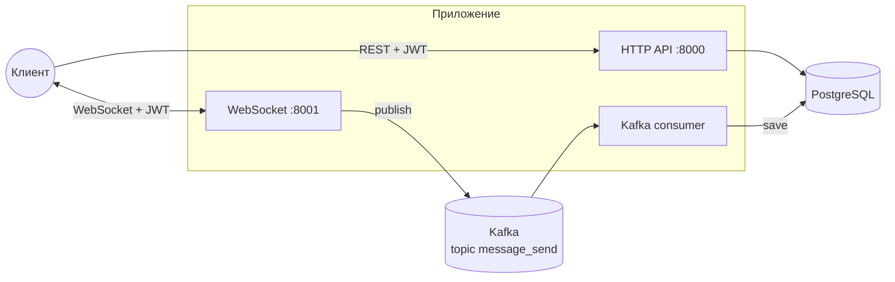

# Messanger

Backend мессенджера на Go: регистрация и JWT-авторизация, обмен личными сообщениями в реальном времени через WebSocket, асинхронное сохранение сообщений через Kafka, история переписки с пагинацией.

**Стек:** Go 1.24 · Echo · gorilla/websocket · PostgreSQL (pgx/v5) · Kafka (segmentio/kafka-go) · goose · JWT · Docker Compose · GitHub Actions

## Архитектура



Путь сообщения:

1. Клиент подключается к WebSocket с JWT-токеном и отправляет `{"to": "bob", "text": "привет"}`.
2. Сервер проверяет получателя и текст, публикует сообщение в Kafka.
3. Если получатель онлайн, сообщение сразу доставляется во все его открытые соединения (несколько вкладок или устройств). Отправитель получает подтверждение `sent`.
4. Консьюмер читает топик и сохраняет сообщение в PostgreSQL. Offset коммитится только после успешной записи (at-least-once), временные ошибки БД обрабатываются повторными попытками.

Ключ сообщения в Kafka одинаков для обоих направлений диалога, поэтому сообщения одной переписки попадают в одну партицию и сохраняют порядок.

## Быстрый старт

Нужен только Docker:

```bash
docker compose up -d --build
```

Поднимутся PostgreSQL, Kafka, применятся миграции и запустится приложение:
- HTTP API — `http://localhost:8000`
- WebSocket — `ws://localhost:8001/ws`
- Kafka UI (по желанию) — `docker compose --profile tools up -d kafka-ui`, затем `http://localhost:8080`

Запуск приложения из IDE, когда в Docker только инфраструктура:

```bash
make infra     # postgres + kafka
make migrate   # миграции
make run       # приложение
```

## API

| Метод | Путь | Авторизация | Описание |
|---|---|---|---|
| GET | `/health` | — | Проверка доступности |
| POST | `/register` | — | Регистрация `{"username", "password"}` → `201` |
| POST | `/login` | — | Вход → `{"token": "..."}` |
| GET | `/me` | JWT | Текущий пользователь |
| GET | `/users/:username` | JWT | Профиль пользователя |
| GET | `/messages/:username?limit=50&offset=0` | JWT | История переписки, новые сообщения первыми |
| GET (WS) | `ws://localhost:8001/ws?token=...` | JWT | Отправка и получение сообщений |

Токен передаётся в заголовке `Authorization: Bearer <token>`. Для WebSocket можно передать его в query-параметре `?token=`, потому что браузерный WebSocket не умеет отправлять заголовки.

Ошибки возвращаются с понятными статусами: `400` — невалидные данные, `401` — неверный логин или токен, `404` — пользователь не найден, `409` — username занят.

### Пример

```bash
# регистрация двух пользователей
curl -X POST localhost:8000/register -H 'Content-Type: application/json' \
     -d '{"username":"alice","password":"secret123"}'
curl -X POST localhost:8000/register -H 'Content-Type: application/json' \
     -d '{"username":"bob","password":"secret123"}'

# вход
TOKEN=$(curl -s -X POST localhost:8000/login -H 'Content-Type: application/json' \
     -d '{"username":"alice","password":"secret123"}' | jq -r .token)

# отправка сообщения через WebSocket (https://github.com/vi/websocat)
websocat "ws://localhost:8001/ws?token=$TOKEN"
{"to":"bob","text":"Привет, Боб!"}

# история переписки
curl localhost:8000/messages/bob -H "Authorization: Bearer $TOKEN"
```

### Протокол WebSocket

Клиент → сервер:
```json
{"to": "bob", "text": "Привет!"}
```

Сервер → клиент:
```json
{"type": "message", "message": {"from": "alice", "to": "bob", "text": "Привет!", "created_at": "..."}}
{"type": "sent",    "message": {"from": "alice", "to": "bob", "text": "Привет!", "created_at": "..."}}
{"type": "error",   "error": "receiver not found"}
```

Соединение поддерживается ping/pong. Невалидный JSON не разрывает соединение: клиент получает кадр `error`.

## Структура проекта

```
cmd/                 точка входа приложения
migrations/          мигратор (goose, SQL вшит в бинарник через embed)
configs/             конфиг для локального запуска
internal/
  app/               сборка зависимостей, запуск и graceful shutdown
  auth/              выпуск и проверка JWT
  broker/            Kafka producer и consumer
  entity/            доменные модели, ошибки и интерфейсы
  http/              REST-обработчики
  logic/             бизнес-логика (валидация, регистрация, история)
  middleware/        JWT-middleware
  repository/        работа с PostgreSQL
  websocket/         WebSocket-сервер и хаб соединений
pkg/
  config/            загрузка конфига (JSON + переменные окружения)
  postgres/          пул соединений
```

Слои зависят друг от друга через интерфейсы из `entity`, поэтому бизнес-логика тестируется без базы и Kafka.

## Конфигурация

Базовые значения лежат в `configs/local.json` (путь можно сменить через `CONFIG_PATH`), переменные окружения их переопределяют:

| Переменная | Назначение |
|---|---|
| `JWT_SECRET` | **обязательна**, секрет для подписи токенов |
| `JWT_TTL` | время жизни токена, по умолчанию `24h` |
| `POSTGRES_HOST`, `POSTGRES_PORT`, `POSTGRES_USER`, `POSTGRES_PASSWORD`, `POSTGRES_DB` | подключение к БД |
| `KAFKA_BROKERS`, `KAFKA_TOPIC`, `KAFKA_GROUP_ID` | Kafka |
| `HTTP_PORT`, `WS_PORT` | порты серверов |

## Тесты

```bash
make test
```

Покрыты бизнес-логика (регистрация, вход, валидация сообщений, пагинация), JWT, middleware авторизации и загрузка конфига. Тесты запускаются в CI (GitHub Actions) на каждый push.

## Что можно развить

- групповые чаты;
- статусы «доставлено» и «прочитано»;
- доставка сообщений между несколькими инстансами приложения (Redis pub/sub или отдельный consumer group на каждый инстанс);
- интеграционные тесты репозиториев на testcontainers;
- refresh-токены.
